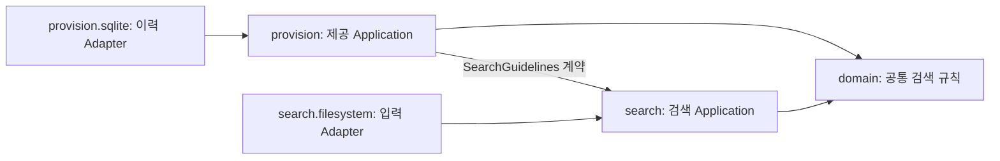
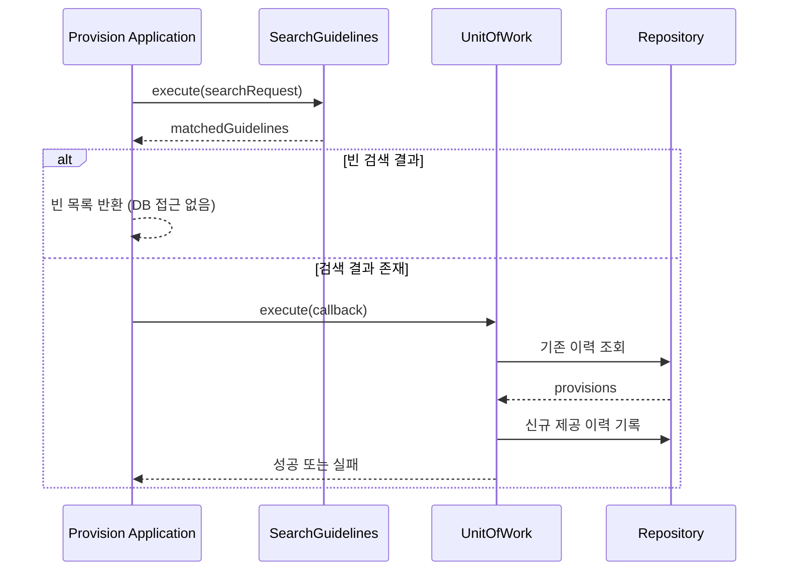

# 독자가 이해하는 순서에 맞춘 PR 본문 구조

## 읽기 순서

**첫 문단**에서 변경 이유와 가장 중요한 영향 또는 위험을 두 문장 내외로 설명합니다. 서로 다른 검토 주제는 `###` 서브헤딩으로 구분합니다. 표와 다이어그램은 비교하거나 관계를 설명하는 데 도움이 될 때만 사용합니다.

- **문제**: 기존의 어려움과 증상, 비용
- **변경**: 실제로 바뀐 동작과 책임
- **선택 이유**: 책임 경계/구현/정책을 선택한 근거
- **영향**: 호환성 중단과 데이터/운영/배포/롤백 비용
- **검증**: 실제로 확인한 사항과 아직 확인하지 못한 사항
- **리뷰 질문**: 승인/수정/보류할 설계 선택

## 언제 서브헤딩을 사용할까

한 문단에 서로 다른 주제가 섞이면 나눕니다.

| 내용의 종류 | 권장 서브헤딩 |
| --- | --- |
| domain, search, provision의 책임/협력 | `### 도메인과 Slice 책임` |
| public API, FQCN, 호출자 전환 | `### 공개 API와 호환성` |
| SQLite, UnitOfWork, 실패/재시도 | `### 이력 저장과 트랜잭션` |
| 실행 CLI, Hook, 종료 코드 | `### 실행 경계` |
| 테스트 편집과 문서 삭제 | `### 검증 범위 및 계약 문서` |

서브헤딩 아래에 설명이 한 문장뿐이라면 상위 섹션에 합쳐도 됩니다. 고정된 헤딩의 개수나 문단 글자 수로 무조건 분리하지 않습니다. 독자가 한 가지 판단 단위를 찾을 수 있는지가 기준입니다.

## 설명 방식 선택

| 정보의 형태 | 우선하는 표현 | 주의사항 |
| --- | --- | --- |
| 두 구조의 책임/소유권 변화 | 전후 비교표 | 기존/변경의 한 열에 여러 무관한 개념을 압축하지 않음 |
| API/DB/정책 변경 | 계약 비교표 | 변경된 기본값/호환성/이력 처리와 같은 중요한 위험은 서두에도 강조 |
| 의존 방향/협력 구조 | Mermaid `flowchart` | 코드에서 확인한 관계만 그리기 |
| 호출 순서/트랜잭션 경계 | Mermaid `sequenceDiagram` | 실제 실행 경계와 반환/실패 경로를 구분 |
| 문제 → 선택 → 트레이드오프 | 짧은 문단 | 화살표/표로 근거와 판단을 생략하지 않음 |
| 검증 명령/결과/한계 | 간단한 검증표 또는 짧은 문단 | 명령을 실행했다는 사실과 결과의 성공을 혼동하지 않음 |
| 이슈별 검토 포인트 | 짧은 목록 | 읽는 사람이 선택할 구체 질문으로 작성 |

### 비교표 예시

| 책임 | 이전 | 변경 후 | 판단할 영향 |
| --- | --- | --- | --- |
| 검색 규칙 | `core`/`features.search`에 분산 | 공통 도메인 규칙은 `domain`, 검색 흐름은 `search` | 검색/제공 책임의 경계를 검토 |
| 제공 이력 | `features.presentation` | `provision` | 공개 API 변경 여부 확인 |
| 이력 저장 | 기존 이름의 저장 모델 | `provision` 테이블 | 이전 이력 미사용 및 마이그레이션 미제공 |

실제 PR에 사용할 때는 Diff를 확인하고 표의 항목을 맞춥니다. 표에는 무엇이 달라졌는지 적고, 주변 문단에서는 선택 이유를 설명합니다. 표에 쓴 내용을 문단에서 반복하지 않습니다.

### 관계도 예시

이 그림은 PR #38의 주요 협력 관계를 단순하게 나타낸 예시입니다. 전체 구현의 의존 관계를 확정하지는 않습니다. 실제 문서에 넣을 때는 선언된 계약과 런타임 조립의 의존 방향을 분리해 확인합니다. Mermaid에서는 화살표가 무엇을 뜻하는지 반드시 정의합니다. 필요한 경우 `의존 방향`과 `호출 흐름`을 별도 그림으로 나눕니다.

### 시퀀스 다이어그램 예시

이 그림은 주요 호출 관계를 설명하는 예시입니다. 정확한 트랜잭션 경계/예외 처리 및 저장 순서는 실제 코드와 함께 대조합니다. 오류가 발생할 때의 분기는 중요한 경우에만 더 추가합니다.

## 읽기 쉬운지 확인하기

- 독자는 첫 두 문장만 읽어도 기존 문제와 가장 큰 변경을 이해할 수 있어야 합니다.
- 처음 읽는 독자가 `BC`, `Slice`, `Factory`, `UnitOfWork`를 이미 알 것이라고 가정하지 않습니다. 이해에 필요한 개념은 간단히 설명해야 합니다.
- 아키텍처, API, DB, 주석, 테스트처럼 서로 다른 주제는 문단을 나누어 설명해야 합니다.
- 핵심 위험은 긴 기술 설명보다 먼저 알려야 합니다.
- 관계가 복잡하면 독자가 직접 추측하지 않도록 표나 그림으로 설명해야 합니다.
- 표나 그림을 추가하더라도 본문에 근거, 예외와 위험을 남겨야 합니다.
- 표는 모바일이나 좁은 화면에서도 읽을 수 있어야 합니다.
- 다이어그램이 없어도 본문에서 중요한 계약을 이해할 수 있어야 합니다.

## 피할 표현

- 개념을 나열한 뒤 `README에서 확인하세요`라고만 쓰지 않습니다. 핵심 판단 정보는 본문에 남깁니다.
- 변경 없는 패키지/파일 목록을 예쁘게 그리기 위해 큰 Mermaid 그래프를 만들지 않습니다.
- 1열 표로 단순 목록을 대체하지 않습니다.
- 측정하거나 확인하지 않은 수치와 실행 결과를 그래프나 표에 넣지 않습니다.

## GitHub 지원 자료

- [GitHub: Markdown 표](https://docs.github.com/en/get-started/writing-on-github/working-with-advanced-formatting/organizing-information-with-tables)
- [GitHub: 다이어그램](https://docs.github.com/en/get-started/writing-on-github/working-with-advanced-formatting/creating-diagrams)