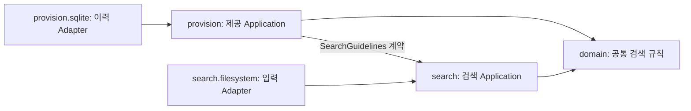
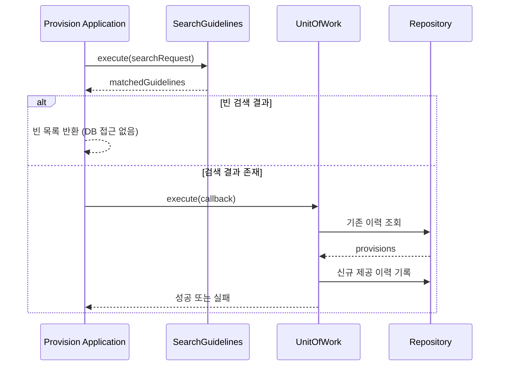

# 독자가 이해하는 순서에 맞춘 PR 본문 구조

## 읽기 순서

**첫 문단**에는 변경의 목적과 가장 큰 효과 또는 위험을 두 문장 내외로 설명한다. 다음은 독자에게 필요한 판단에 따라 `###` 서브헤딩으로 구분한다. 표와 다이어그램은 각 섹션의 판단을 지원하는 도구다. 단지 Markdown을 풍성하게 만들기 위해 사용하지 않는다.

- **문제**: 무엇이 어려웠고, 그 증상·비용은 무엇인가.
- **변경**: 실제 바뀐 행동과 책임은 무엇인가.
- **선택 이유**: 왜 그 책임 경계·구현·정책을 채택했는가.
- **영향**: 호환성 중단, 데이터·운영·배포·롤백 비용은 무엇인가.
- **검증**: 실제 수행한 확인과 아직 검증하지 못한 부분은 무엇인가.
- **리뷰 질문**: 어떤 설계 선택을 승인/수정/보류할 것인가.

## 언제 서브헤딩을 사용할까

한 문단에 다음처럼 서로 다른 종류의 명제가 섞이면 분리한다.

| 내용의 종류 | 권장 서브헤딩 |
| --- | --- |
| domain, search, provision의 책임·협력 | `### 도메인과 Slice 책임` |
| public API, FQCN, 호출자 전환 | `### 공개 API와 호환성` |
| SQLite, UnitOfWork, 실패·재시도 | `### 이력 저장과 트랜잭션` |
| 실행 CLI, Hook, 종료 코드 | `### 실행 경계` |
| 테스트 편집과 문서 삭제 | `### 검증 범위 및 계약 문서` |

서브헤딩이 한 문장밖에 설명하지 않는다면 위 단계의 섹션으로 합칠 수 있다. 고정된 헤딩의 개수나 문단 글자 수로 무조건 분리하지 않는다. 독자가 한 가지 판단 단위를 찾을 수 있는지가 기준이다.

## 어떤 내용을 어떤 형식으로 전달할까

| 정보의 형태 | 우선하는 표현 | 주의사항 |
| --- | --- | --- |
| 두 구조의 책임·소유권 변화 | 전후 비교표 | 기존/변경의 한 열에 여러 무관한 개념을 압축하지 않음 |
| API·DB·정책 변경 | 계약 비교표 | 변경된 기본값·호환성·이력 처리와 같은 중요한 위험은 서두에도 강조 |
| 의존 방향·협력 구조 | Mermaid `flowchart` | 관계를 검증한 코드에 기반해 그릴 것 |
| 호출 순서·트랜잭션 경계 | Mermaid `sequenceDiagram` | 실제 실행 경계와 반환·실패 경로를 구분 |
| 문제 → 선택 → 트레이드오프 | 짧은 문단 | 화살표/표로 근거와 판단을 생략하지 않음 |
| 검증 명령·결과·한계 | 간단한 검증표 또는 짧은 문단 | 명령을 실행했다는 사실과 결과의 성공을 혼동하지 않음 |
| 이슈별 검토 포인트 | 짧은 목록 | 읽는 사람이 선택할 구체 질문으로 작성 |

### 비교표 예시

| 책임 | 이전 | 변경 후 | 판단할 영향 |
| --- | --- | --- | --- |
| 검색 규칙 | `core`·`features.search`에 분산 | 공통 도메인 규칙은 `domain`, 검색 흐름은 `search` | 검색·제공 책임의 경계를 검토 |
| 제공 이력 | `features.presentation` | `provision` | 공개 API 변경 여부 확인 |
| 이력 저장 | 기존 이름의 저장 모델 | `provision` 테이블 | 이전 이력 미사용 및 마이그레이션 미제공 |

실제 PR에 사용하려면 검증된 Diff에 따라 항목을 수정한다. 표 아래에서 모든 행을 다시 서술하지 않는다. 표는 `무엇이 달라졌는지`, 앞뒤의 짧은 문단은 `왜 선택했는지`를 맡는다.

### 관계도 예시

이 그림은 전체 구현 의존성을 확정하는 자료가 아니라, PR #38 설명의 주요 협력 관계를 간략화한 예시다. 실제 문서에 넣을 때는 선언된 계약과 런타임 조립의 의존 방향을 분리해 확인한다. Mermaid에서는 화살표가 무엇을 뜻하는지 반드시 정의한다. 필요한 경우 `의존 방향`과 `호출 흐름`을 별도 그림으로 나눈다.

### 시퀀스 다이어그램 예시

이 예시는 상호작용을 이해시키는 개념 그림이다. 정확한 트랜잭션 경계·예외 처리 및 저장 순서는 실제 코드와 함께 대조한다. 오류가 발생할 때의 분기는 중요한 경우에만 더 추가한다.

## 가독성 자체를 검토하는 질문

- 첫 두 문장만 읽으면 이전 문제와 가장 큰 변경이 이해되는가?
- 처음 보는 독자가 `BC`, `Slice`, `Factory`, `UnitOfWork`를 알고 있다고 가정하는가? 필요한 개념은 최소한 설명했는가?
- 한 문단에서 아키텍처 → API → DB → 주석 → 테스트로 주제를 넘나드는가?
- 핵심 위험이 긴 기술적 설명 뒤에 숨어 있는가?
- 표·그림이 없는 상태에서 독자가 직접 관계를 복원해야 하는가?
- 표나 그림이 추가되면서 텍스트의 근거·예외·위험이 빠지지는 않았는가?
- 모바일 화면이나 좁은 화면에서 표가 지나치게 넓지는 않은가?
- 다이어그램 없이 읽더라도 본문에 중요 계약이 남아 있는가?

## 사용하지 않아야 할 표현

- 개념을 나열한 뒤 `README에서 확인하세요`라고만 쓰지 않는다. 핵심 판단 정보는 본문에 남긴다.
- 변경 없는 패키지·파일 목록을 예쁘게 그리기 위해 큰 Mermaid 그래프를 만들지 않는다.
- 1열 표로 단순 목록을 대체하지 않는다.
- 실측하지 않은 수치·실행 결과를 그래프나 표에 넣지 않는다.

## GitHub 지원 자료

- [GitHub: Markdown 표](https://docs.github.com/en/get-started/writing-on-github/working-with-advanced-formatting/organizing-information-with-tables)
- [GitHub: 다이어그램](https://docs.github.com/en/get-started/writing-on-github/working-with-advanced-formatting/creating-diagrams)