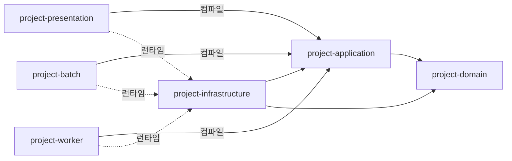

# 모듈구조

이 문서의 그래프는 멀티모듈 템플릿의 물리적인 Gradle 모듈 구성을 설명합니다. BC와 Slice는 논리적인 모델·유스케이스 소유권을 나타내므로 물리 모듈과 일대일로 대응하지 않습니다.

Agent Guidebook은 단일 Gradle 모듈이며 `com.springkit.agentguidebook`이 하나의 BC입니다. 그 안에서 `search`와 `presentation`이 각각 Slice를 소유합니다. 아래 멀티모듈 그래프는 이 패키지 구조를 강제하지 않는 일반 템플릿입니다.

## 의존성 방향

`domain`은 다른 프로젝트 모듈에 의존하지 않습니다. 도메인 모델과 업무
규칙은 외부 프레임워크를 참조하지 않습니다.

`application`은 `domain`에만 의존합니다. 유스케이스와 외부 시스템을
사용하기 위한 포트는 `application`에 둡니다.

`infrastructure`는 `application` 포트를 구현하며 `application`과 `domain`에
의존합니다.

`presentation`, `batch`, `worker`는 `application`을 컴파일 시점에
의존하고 `infrastructure`를 런타임에 의존합니다.

JPA, Kotlin JDSL, MySQL과 같은 영속성 기술은 `infrastructure` 안에서만
사용합니다. 해당 라이브러리와 프레임워크 타입은 다른 모듈에 노출하지
않습니다.
